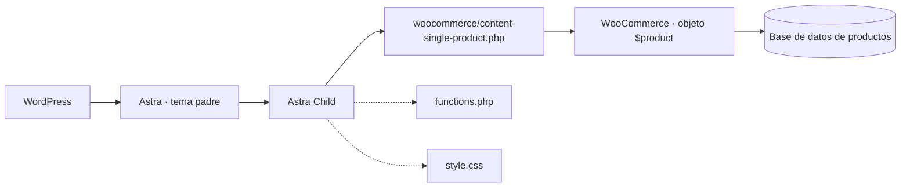
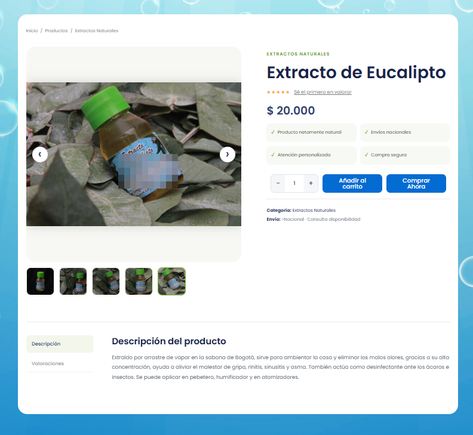
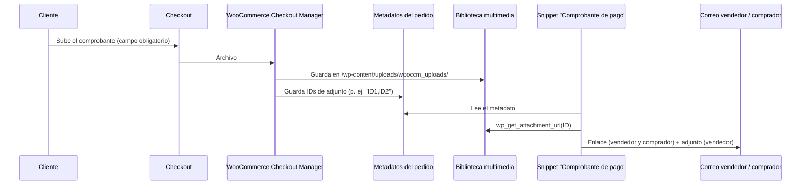

# Limpia Mar MC · Estabilización de una tienda WooCommerce

Documentación técnica y código de la intervención realizada sobre una tienda **WordPress + WooCommerce** que ya estaba en producción: plantilla de producto, flujo de comprobantes de pago, error crítico en el checkout y una pasarela de pago QR desarrollada a medida.

> **Dossier visual:** <https://artworldartistico.github.io/andresrodriguez/dossier/wordpress-woocommerce> · **Sitio:** <https://www.limpiamarmc.com.co/>

---

## 1. Descripción general

La tienda vende productos naturales y funcionaba con WordPress, WooCommerce y el tema Astra. Tras actualizar el tema y los plugins aparecieron inconsistencias de datos y fallos en el checkout. Este repositorio reúne el código, la documentación y las evidencias (anonimizadas) de cómo se diagnosticaron y resolvieron.

Este proyecto **no** es una guía para crear una tienda: documenta diagnóstico, decisiones de arquitectura y soluciones a medida sobre una tienda existente.

## 2. Contexto y objetivo

Recuperar la confiabilidad de la tienda y reducir su dependencia de componentes visuales que fallaban tras las actualizaciones, sin sobrecostos de licencias para el cliente.

## 3. Problemas identificados

| # | Incidente | Causa | Estado de la evidencia |
|---|---|---|---|
| 1 | Productos con datos que no coincidían (precio, imágenes, galería, descripción) | **Confirmado:** contenido incrustado fijo en la plantilla de Elementor. **Hipótesis:** caché sirviendo contenido cruzado | Causa parcial confirmada; sin capturas del estado anterior |
| 2 | Comprobantes de pago que no llegaban | El plugin de campos guarda **IDs de adjuntos**, no URLs | Confirmado con un correo de diagnóstico |
| 3 | "Se produjo un error al procesar tu pedido" | `TypeError` de `strpos()` sobre un array en un snippet propio (no la pasarela) | Reportado por el registro de errores; extracto no publicado |
| 4 | Lentitud y elementos que no cargaban | Falta de mantenimiento continuo (reportado) | Sin métricas antes/después |

Detalle por incidente: [`docs/diagnostico.md`](docs/diagnostico.md).

## 4. Arquitectura tecnológica



Más detalle en [`docs/arquitectura.md`](docs/arquitectura.md).

## 5. Tecnologías utilizadas

WordPress · WooCommerce · Astra (+ tema hijo) · PHP · HTML/CSS/JavaScript · Code Snippets · WooCommerce Checkout Manager (WOOCCM) · Quick Buy Now Button for WooCommerce · LiteSpeed Cache.

## 6. Estructura de directorios

```text
limpiamar-mc/
├── README.md
├── dossier/
│   ├── index.html
│   └── assets/ (css, js, images)
├── wordpress/
│   ├── astra-child/
│   │   ├── functions.php
│   │   ├── style.css
│   │   └── woocommerce/content-single-product.php
│   ├── plugins/wc-custom-qr-gateway.php
│   └── snippets/
│       ├── comprobante-de-pago.php
│       └── cambios-en-checkout.php
├── docs/ (arquitectura, diagnostico, implementacion, pruebas, mantenimiento, evidencias)
└── screenshots/ (arquitectura, productos, checkout, comprobantes, resultados)
```

## 7. Componentes: propios y de terceros

| Componente | Origen |
|---|---|
| Tema hijo, plantilla de producto | **Desarrollo propio** |
| Plugin `wc-custom-qr-gateway.php` | **Desarrollo propio** |
| Snippets "Comprobante de pago" y "Cambios en checkout" | **Desarrollo propio** |
| WordPress, WooCommerce, Astra | Terceros |
| WooCommerce Checkout Manager, Code Snippets, LiteSpeed Cache, Quick Buy Now Button for WooCommerce | Terceros (plugins existentes) |
| Elementor Theme Builder | Terceros (usado anteriormente) |

## 8. Tema hijo de Astra

Ruta: `wp-content/themes/astra-child/`.

- `functions.php`: encola la hoja de estilos del tema padre y la del hijo (dependiente de la del padre).
- `style.css`: encabezado del tema hijo (`Template: astra`); sin reglas propias.
- `woocommerce/content-single-product.php`: sobrescribe la plantilla de producto individual.

**Ventaja:** las personalizaciones no se pierden al actualizar Astra. **Límite:** el tema hijo no elimina la necesidad de revisar la plantilla sobrescrita cuando WooCommerce actualiza su plantilla de origen.

## 9. Plantilla personalizada de WooCommerce

Lee cada dato del objeto `$product` del producto cargado en la URL (`wc_get_product( get_the_ID() )`):

| Campo | Fuente |
|---|---|
| Título | `get_name()` |
| Precio | `get_price_html()` |
| Descripción corta / larga | `get_short_description()` / `get_description()` |
| Valoración | `get_average_rating()`, `get_review_count()` |
| Imagen y galería | `get_image_id()`, `get_gallery_image_ids()` |
| Añadir al carrito | `woocommerce_template_single_add_to_cart()` (formulario nativo) |
| Comprar ahora | Plugin Quick Buy Now, vía `woocommerce_after_add_to_cart_button` |

CSS y JS están dentro de la plantilla, prefijados con `.lmc-` (raíz `.lmc-single-product`) para no afectar el resto del sitio. No ejecuta `woocommerce_before_single_product_summary` ni `woocommerce_after_single_product_summary`.



## 10. Plugin personalizado de pago QR

`wordpress/plugins/wc-custom-qr-gateway.php`: extiende `WC_Payment_Gateway`, en un solo archivo (PHP + CSS + JS).

| Opción | Comportamiento según el código |
|---|---|
| Habilitar, título, descripción | Estándar de pasarela |
| Imagen del QR y logo | URL con selector de la biblioteca multimedia |
| Métodos de envío permitidos | Filtra la disponibilidad del método por el envío elegido (por *instance id*) |
| Costos extra por ciudad | Línea `Ciudad:Costo`; agrega un cargo si el pago elegido es QR y la ciudad coincide |

> El código implementa las dos últimas opciones, pero este repositorio **no incluye una prueba** que demuestre su funcionamiento.

## 11. Integración de comprobantes de pago



## 12. Snippets personalizados

- **Comprobante de pago** (`woocommerce_email_order_meta`, `woocommerce_email_attachments`).
- **Cambios en checkout** (columna ID en Ajustes → Pagos y `woocommerce_gateway_icon`). Las URLs de iconos están sustituidas por marcadores (`example.com`).

## 13. Procedimiento de instalación

Resumen (detalle en [`docs/implementacion.md`](docs/implementacion.md)):

1. Subir `wordpress/astra-child/` a `wp-content/themes/` y activar el tema hijo.
2. Pegar cada snippet en un fragmento nuevo del plugin Code Snippets (ejecutar en todo el sitio).
3. Comprimir `wc-custom-qr-gateway.php` en ZIP, instalarlo desde Plugins → Añadir nuevo → Subir plugin y activarlo.
4. Purgar la caché (LiteSpeed Cache → *Purge All*).

## 14. Configuración

- WooCommerce → Ajustes → Pagos → **Pago con QR**: título, descripción, imagen del QR, logo, envíos permitidos y costos por ciudad.
- Campo obligatorio para subir el comprobante en el checkout (WooCommerce Checkout Manager).
- Reemplazar los marcadores `example.com` del snippet de iconos por las imágenes reales de la biblioteca multimedia.

## 15. Pruebas y validaciones

Pedido de prueba con **Pago con QR** validado de extremo a extremo (checkout, confirmación, correos). Matriz completa, incluidas las pruebas pendientes: [`docs/pruebas.md`](docs/pruebas.md).

## 16. Seguridad y mantenimiento

- Capturas anonimizadas: QR, datos bancarios, números de contacto, nombres de compradores, números de pedido y nombres de archivos.
- No se incluyen pedidos, comprobantes ni credenciales.
- Procedimiento de actualización y caché: [`docs/mantenimiento.md`](docs/mantenimiento.md).

## 17. Limitaciones conocidas

- Comprobantes: solo se enlaza el **primer** archivo; el adjunto va solo en el correo `new_order`; el acceso a `/wp-content/uploads/` no se verificó.
- Plantilla: no ejecuta los hooks de resumen de producto; beneficios y línea de envío son texto fijo; hay un `>` sobrante junto a "Envío"; el botón fijo móvil solo desplaza al formulario.
- Plugin QR: `strtolower()` no iguala acentos en mayúsculas; clases CSS del checkout sin prefijo; envíos guardados por *instance id*.
- Snippet de iconos: la condición `|| 'paypal'` es siempre verdadera, sin efecto práctico.
- Sin métricas de rendimiento antes/después y sin capturas del estado previo a la solución.

## 18. Evidencias visuales

| Archivo | Muestra |
|---|---|
| `screenshots/arquitectura/01-estructura-astra-child.png` | Tema hijo en el servidor |
| `screenshots/checkout/02-config-pasarela-qr.png` | Ajustes del método QR |
| `screenshots/checkout/03-checkout-pago-qr-comprobante.png` | Método QR en el checkout |
| `screenshots/resultados/04-pedido-recibido.png` | Pedido de prueba recibido |
| `screenshots/comprobantes/05-correo-vendedor-enlace.png` | Correo del vendedor |
| `screenshots/resultados/06-error-checkout.png` | Error original del checkout |
| `screenshots/comprobantes/07-correo-comprador-enlace.png` | Correo del comprador |
| `screenshots/checkout/08-checkout-transferencia-comprobante.png` | Campo obligatorio de comprobante |
| `screenshots/productos/09-producto-plantilla-escritorio.png` | Plantilla de producto |

Lista completa y pendientes: [`docs/evidencias.md`](docs/evidencias.md).

## 19. Cambios aplicados para publicar

- `wc-custom-qr-gateway.php`: solo el encabezado (autor, URIs, licencia). La lógica no se modificó.
- `cambios-en-checkout.php`: URLs reales sustituidas por `example.com` y eliminadas dos ramas de ejemplo con URL de prueba.
- Resto de archivos de `wordpress/`: copia sin cambios del código en producción.
- `dossier/assets/css/dossier.css` y `dossier.js`: copia sin cambios de los archivos de los dossiers publicados.

## 20. Autor y enlaces

**Andrés Felipe Rodríguez Barbosa**

- Portafolio: <https://artworldartistico.github.io/andresrodriguez/>
- GitHub: <https://github.com/artworldartistico>
- LinkedIn: <https://www.linkedin.com/in/andr%C3%A9s-felipe-rodr%C3%ADguez-barbosa-53b4a915a/>

**Licencia:** el código de `wordpress/` se publica bajo GPL-2.0-or-later, compatible con WordPress y WooCommerce. Añade el archivo `LICENSE` desde GitHub al crear el repositorio.
