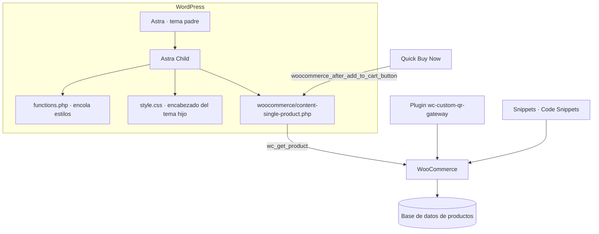

# Arquitectura

## Capas

## Ruta y archivos del tema hijo

`wp-content/themes/astra-child/`

| Archivo | Responsabilidad |
|---|---|
| `functions.php` | Encola el `style.css` del tema padre (`tema-padre`) y el del hijo (`tema-hijo`, dependiente del anterior y versionado con la versión del tema). |
| `style.css` | Encabezado del tema hijo (`Template: astra`). Sin reglas propias: los estilos de la plantilla viven dentro de la plantilla, con prefijo `.lmc-`. |
| `woocommerce/content-single-product.php` | Sobrescribe la plantilla de contenido de producto individual. |

## Tema padre vs. tema hijo

- **Modificar el padre:** el cambio se pierde al actualizar Astra.
- **Sobrescribir desde el hijo:** WooCommerce busca la plantilla primero en `tema-hijo/woocommerce/`; el padre queda intacto.
- **Límite:** el hijo no elimina la necesidad de revisar la plantilla sobrescrita cuando WooCommerce actualiza su plantilla de origen. El archivo no declara `@version`, por lo que el informe de estado de WooCommerce no puede avisar de desfases.

## Flujo de datos de la plantilla de producto

La plantilla vuelve a pedir el producto del post actual (`wc_get_product( get_the_ID() )`) y lee cada campo con métodos de `WC_Product`. No hay contenido de producto escrito a mano. Son texto fijo: los "beneficios" y la línea de envío.

| Campo | Origen |
|---|---|
| Título | `get_name()` |
| Precio | `get_price_html()` |
| Descripción corta | `get_short_description()` |
| Descripción larga | `get_description()` (filtro `the_content`) |
| Valoración | `get_average_rating()`, `get_review_count()`, `wc_get_rating_html()` |
| Imagen/galería | `get_image_id()`, `get_gallery_image_ids()` |
| Reseñas | `comments_template()` |
| Relacionados | `wc_get_related_products()` |
| Carrito | `woocommerce_template_single_add_to_cart()` |

La plantilla **no** ejecuta `woocommerce_before_single_product_summary` ni `woocommerce_after_single_product_summary`, para no duplicar galería, pestañas ni relacionados.

## Plugin de pago QR

Clase que extiende `WC_Payment_Gateway`. Hooks usados: `woocommerce_update_options_payment_gateways_{id}`, `woocommerce_thankyou_{id}`, `admin_enqueue_scripts` (selector de medios), `wp_head` (CSS solo en checkout), `woocommerce_available_payment_gateways` (filtro por envío) y `woocommerce_cart_calculate_fees` (cargo por ciudad).

## Snippets

| Snippet | Hooks |
|---|---|
| Comprobante de pago | `woocommerce_email_order_meta`, `woocommerce_email_attachments` |
| Cambios en checkout | `woocommerce_payment_gateways_setting_columns`, `woocommerce_payment_gateways_setting_column_id`, `woocommerce_gateway_icon` |
